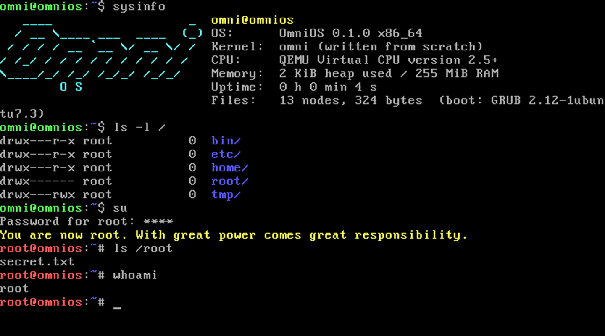

# OmniOS

A 64-bit operating system written **from scratch** in C and x86-64 assembly. No Linux,
no BSD, no borrowed kernel: every line from the boot code to the shell is in this folder.



## What it does today (v0.1.0)

| Layer | What's implemented |
|---|---|
| Boot | Multiboot2 (GRUB), 32-bit → 64-bit long-mode switch, 4 GiB identity-mapped paging |
| CPU | GDT, 48-entry IDT, exception handler with kernel-panic screen, 8259 PIC |
| Devices | 100 Hz PIT timer, PS/2 keyboard (Shift, Caps, Ctrl, arrows), VGA text console, COM1 serial console, CMOS real-time clock, CPUID, ACPI-style power-off, reboot |
| Memory | Multiboot2 memory-map parsing, first-fit kernel heap with block splitting and coalescing |
| Filesystem | OmniFS: hierarchical in-memory filesystem with owners and Unix permission bits (`rwx` for owner/others) |
| Users | `root` (uid 0) and normal users, passwords, `su`, `sudo`, `exit`, `useradd`, `passwd`, `chown`, `chmod`; root bypasses permissions, others are enforced |
| Shell (`omsh`) | Colour prompt (`$` user / `#` root), line editing, history (↑/↓), Tab completion, `;` chaining, `>` and `>>` redirection, quoting |
| Commands | 39 commands: `ls -la tree cd pwd mkdir touch write cat cp mv rm wc grep hexdump chmod chown whoami id users su sudo exit useradd passwd echo calc date uptime free uname history status color sleep clear reboot shutdown sysinfo help` |

Default accounts: `omni` / `omni` (can use sudo), `root` / `root`.

## Run it

**Easiest:** boot `dist/omnios.iso`.

- **QEMU:** `qemu-system-x86_64 -cdrom dist/omnios.iso -m 256M`
- **VirtualBox / VMware:** new VM → type "Other / Unknown (64-bit)" → attach `omnios.iso` as the CD.
- **Real PC:** write the ISO to a USB stick (Rufus / balenaEtcher / `dd`) and boot it with
  legacy BIOS/CSM enabled. Files are kept in RAM, so nothing on the disk is touched.

## Build it

On Ubuntu/Debian:

```sh
sudo apt install build-essential nasm grub-pc-bin grub-common xorriso mtools qemu-system-x86
make            # builds omnios.iso
make run        # boots it in a QEMU window
make run-serial # boots it inside your terminal
make test       # boots it headless and runs 15 automated shell checks
```

## Layout

```
boot/boot.asm      Multiboot2 header, long-mode switch, paging, interrupt stubs
kernel/kernel.c    kmain: boot sequence
kernel/arch.c      IDT, PIC, timer, keyboard, RTC, power, CPUID
kernel/console.c   VGA text + serial output, colour, output capture for redirection
kernel/mem.c       memory map + heap allocator
kernel/fs.c        OmniFS
kernel/shell.c     omsh shell, users and all commands
kernel/lib.c       freestanding libc: strings, memory, printf
tests/boot_test.py QEMU end-to-end test
```

## Honest status and roadmap

OmniOS is a real kernel, but it is **version 0.1**. Linux has ~30 million lines of code and
thousands of contributors; matching it is a multi-year project. Here is what's missing and
the order it would come in:

1. **User mode and processes:** ring-3 programs, system calls, a scheduler, ELF loading.
   Today every command runs inside the kernel, so "root" is enforced by the shell and
   filesystem, not by CPU protection.
2. **Persistent storage:** ATA/AHCI/NVMe drivers and an on-disk filesystem (FAT32 first,
   so files are readable from Windows/macOS/Linux).
3. **UEFI boot and a graphical framebuffer desktop:** windows, mouse, fonts.
4. **Networking:** e1000/virtio NIC driver, TCP/IP stack, DHCP. Once this exists,
   OmniBridge (below) can run natively on OmniOS so phones can connect to it.
5. **USB:** xHCI driver, mass storage, and Android ADB/MTP for cabled phone transfer.
6. **ARM64 port:** needed to run on phones and Raspberry Pi.

**About phones:** Android phones with an unlockable bootloader can in principle run a
custom OS after an ARM64 port and device-specific drivers. **iPhones can't**: Apple's
secure boot only runs Apple-signed operating systems. That's why connecting to phones
is done by [OmniBridge](../omnibridge), which works with every device today.
