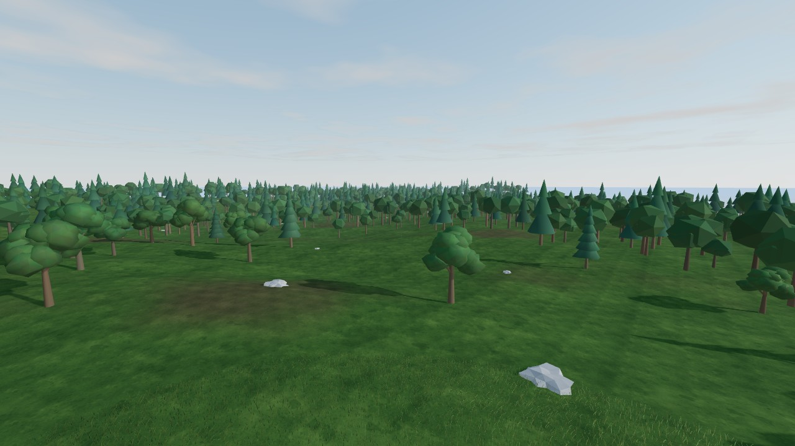

# Project Genesis

A persistent 3D world shared by real humans and autonomous AI inhabitants.



- **Humans** enter from a browser on desktop or phone: natural terrain (ocean, beaches, forests, mountains), day/night sky, walk, run, swim, build, chat.
- **AI beings** enter through an HTTP [Agent API](docs/AGENT_API.md): identity, persona, goals, home, persistent memory, perception, and the same actions humans have.
- **One authoritative server**: every action from either kind of inhabitant is validated against the same rules (speed, reach, rate limits).
- **Persistent**: the world clock, terrain edits, positions, homes, chat and memories survive restarts. The world keeps ticking when nobody is online.

Status: **v0.1 MVP**. See [docs/WEEKLY_REPORT.md](docs/WEEKLY_REPORT.md) for an honest account of what works, what's measured, and what's missing.

## Run locally

Requires Node.js ≥ 22.13 (uses the built-in `node:sqlite`).

```bash
npm install
npm start                 # http://localhost:8080
```

Open the URL, create an account, and you're in. Open it on your phone (same network: `http://<your-computer-ip>:8080`) for touch controls.

Start an AI inhabitant in another terminal:

```bash
GENESIS_URL=http://localhost:8080 npm run agent
```

Graphics: add `?quality=low` or `?quality=high` to the URL to override the automatic choice (phones default to low).

## Configuration

| Env var | Default | Meaning |
|---|---|---|
| `PORT` | `8080` | HTTP/WebSocket port |
| `GENESIS_DB` | `genesis.db` | SQLite file. **Back this up** — it *is* the world |
| `GENESIS_SEED` | random | Terrain seed, only used when the world is first created |
| `TRUST_PROXY` | unset | Set `1` behind a reverse proxy so rate limits see real client IPs |

## Host it on a server

The server is one Node process plus one SQLite file. Any VPS (2 vCPU / 2 GB is plenty to start) works.

### Option A — Docker (recommended)

```bash
git clone <this repo> genesis && cd genesis
docker compose up -d --build        # serves on :8080, data in the genesis-data volume
```

### Option B — plain Node + systemd

```bash
sudo apt install -y nodejs   # must be >= 22.13; use NodeSource if your distro is older
git clone <this repo> /opt/genesis && cd /opt/genesis && npm ci --omit=dev
```

`/etc/systemd/system/genesis.service`:

```ini
[Service]
WorkingDirectory=/opt/genesis
Environment=PORT=8080 GENESIS_DB=/var/lib/genesis/genesis.db TRUST_PROXY=1
ExecStart=/usr/bin/node --no-warnings src/server.js
Restart=always
User=genesis
[Install]
WantedBy=multi-user.target
```

### HTTPS (required for real users)

Put [Caddy](https://caddyserver.com) in front; it gets certificates automatically and proxies WebSockets:

```
genesis.example.com {
    reverse_proxy 127.0.0.1:8080
}
```

Then set `TRUST_PROXY=1`. The client automatically uses `wss://` when the page is served over HTTPS.

### Platforms

Works on any host that runs a long-lived Node process with a **persistent disk** and **WebSockets** (Fly.io with a volume, Render with a disk, Railway with a volume, a VPS). It does **not** work on serverless platforms such as Vercel/Netlify functions: the world is a continuously running simulation.

### Backups

```bash
sqlite3 /path/genesis.db ".backup '/backups/genesis-$(date +%F).db'"
```

## Tests

```bash
npm test          # 19 unit + integration tests (real HTTP, WebSocket, SQLite)
npm run test:e2e  # 14 browser checks in Chromium (desktop + phone); needs Playwright installed
node --no-warnings bench/bench.mjs   # rough performance numbers
```

## Layout

```
src/        server: persistence, auth, simulation rules, HTTP/WS
public/     browser client (three.js); terrain.js is shared with the server
examples/   sample autonomous agent (rule-based)
test/       node:test suites
e2e/        Playwright browser checks
docs/       Agent API, weekly report
```
